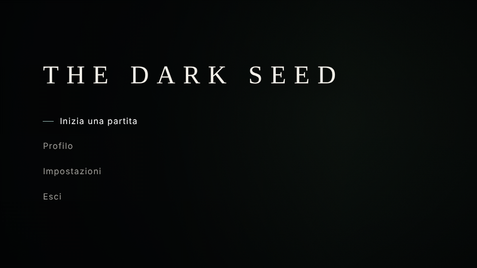
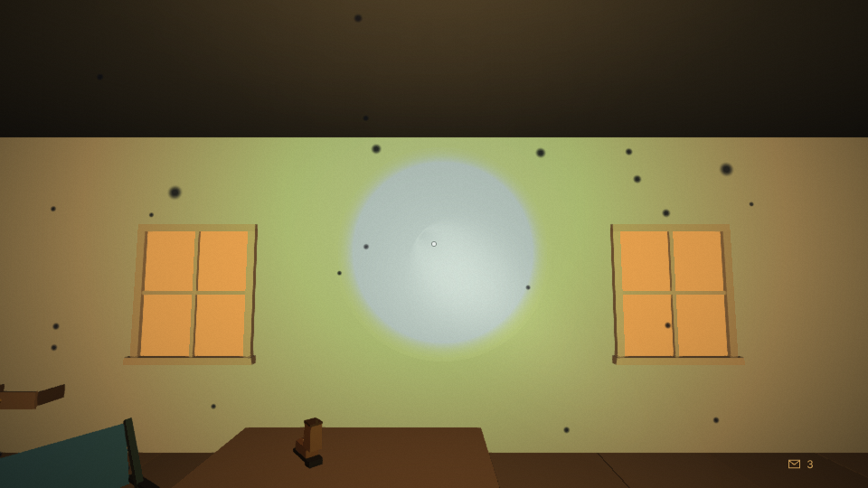
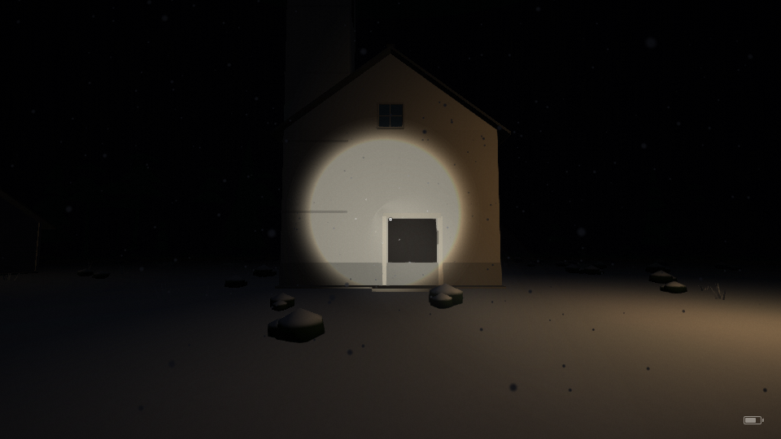
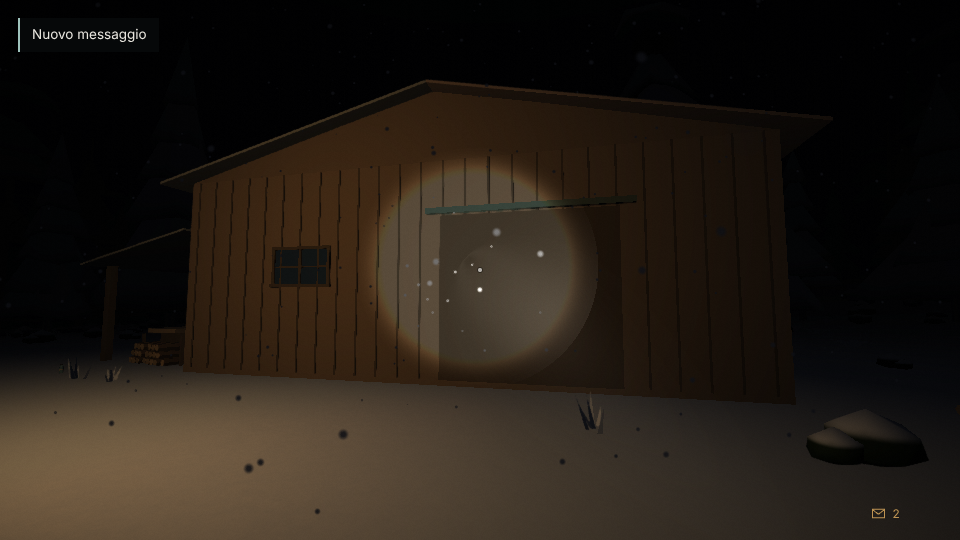
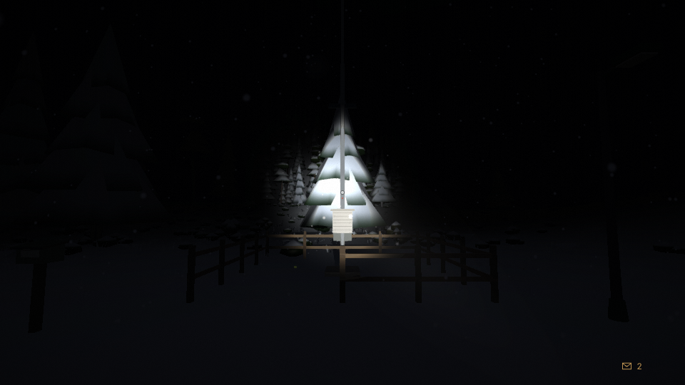
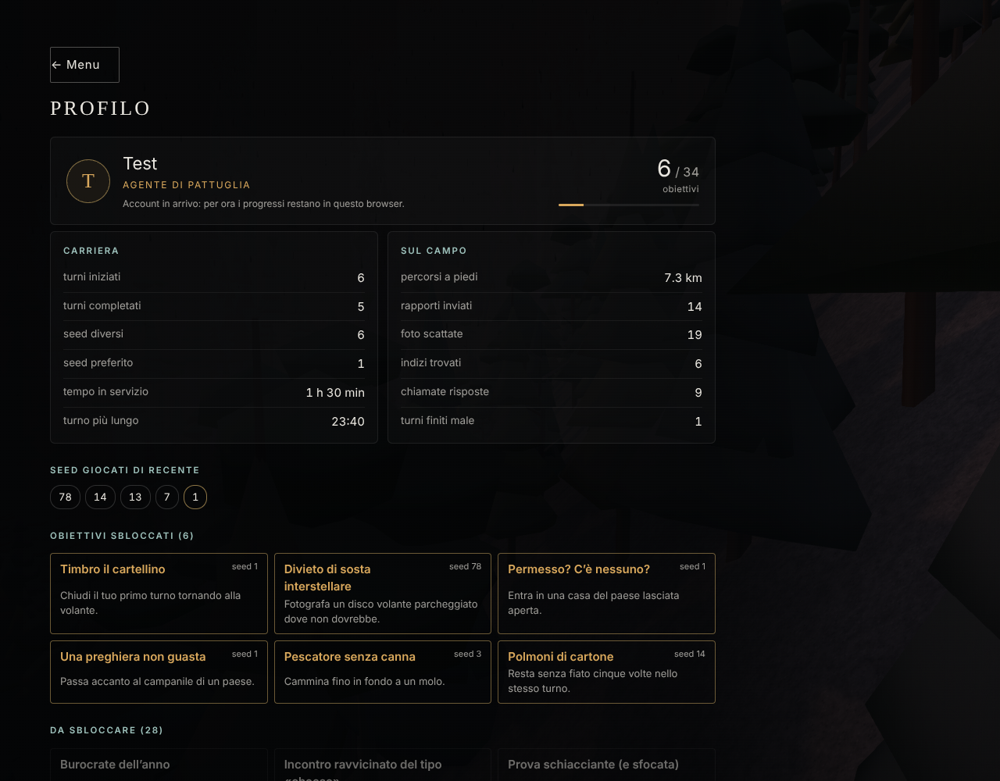

# THE DARK SEED

Horror psicologico procedurale in prima persona per browser desktop. Sei un agente di polizia in turno
notturno in un bosco di montagna di 1 × 1 km: un seed (0–1.000.000) determina mondo, cielo, meteo,
incarichi e ciò che accade attorno a te. Opera originale; tutto (grafica, suoni, testi) è generato dal codice.

Stack: TypeScript · Babylon.js · Vite · WebGL2. Sito statico: nessun backend, nessun LLM, nessuna API key,
nessuna richiesta di rete a runtime.

## Avvio

1. Installa [Node.js](https://nodejs.org) 20 o superiore.
2. Nella cartella del progetto: `npm install`
3. Per giocare subito: `npm run dev` e apri `http://localhost:5173`
4. Per la versione definitiva: `npm run build`, poi `npm run preview` e apri `http://localhost:4173`
5. Per pubblicarla: carica il contenuto della cartella `dist/` su un qualsiasi hosting statico
   (GitHub Pages, Netlify, una cartella su un server). I percorsi sono relativi, funziona anche in sottocartella.

Un seed si può passare anche nell'indirizzo: `…/?seed=4242`.

## Comandi

| Tasto | Azione |
| --- | --- |
| WASD | muoversi (anche col telefono in mano) |
| Shift | correre, finché c'è fiato |
| mouse | guardare |
| clic sinistro o E | interagire, aprire porte e cassetti, raccogliere |
| F | torcia |
| T | telefono: messaggi, incarichi, fotocamera, galleria, mappa |
| M | mappa diretta |
| C | foto rapida |
| R | rispondere alla radio della centrale |
| Esc | pausa |

## Il turno

Ricevi incarichi sul telefono, vai sul posto, guardi, fotografi e mandi il rapporto. La volante parte con i
fari accesi; tornarci serve a scaldarsi e a ricaricare il telefono. I messaggi nuovi compaiono **in alto a
sinistra**, gli altri avvisi in alto a destra.

### Il corpo

- **Fiato**: si corre per circa 16 secondi, poi serve camminare per riprendersi.
- **Freddo**: con neve, pioggia e vento il corpo si gela lentamente. Sotto una certa soglia la visuale trema e
  i passi si accorciano. Ci si scalda alla volante, dentro le case o accanto a un fuoco.
- **Telefono**: si scarica in tasca, molto di più con lo schermo acceso o la fotocamera, e più in fretta col
  freddo. Da spento niente mappa, niente foto, niente rapporti finché non lo ricarichi in macchina.

Nessuno di questi uccide: rallentano e complicano il turno.

### La radio

La centrale chiama durante il turno: controlli di routine, segnalazioni su un posto preciso, avvisi meteo.
Hai una ventina di secondi per rispondere con **R**.

### Il bosco racconta

Ogni turno nasconde una storia. Chi guarda bene trova indizi, e a fine turno quelli raccolti si
ricompongono in un racconto: pochi danno un'ipotesi, tutti la storia completa.

### Luoghi

Il bosco è di 1 km per lato, con più lampioni vicino ai punti di interesse. Oltre a baite, rifugi, campeggi,
distributori e borghi ci sono:

- **case visitabili**: circa una porta su tre è aperta; dentro tavolo, sedie, cassetti con batterie e oggetti;
- **chiese con cimitero** e **fienili** nei borghi;
- **segherie** e **stazioni meteo** isolate;
- **pontili** con barche a remi sui laghi e sul fiume.

### Di notte

Nel bosco non sei sempre solo. Cosa ci sia, dipende dal seed: scoprirlo è parte del gioco.

## Profilo e obiettivi

Dal menu, **Profilo** mostra il nome dell'account (per ora fisso, «Test») e il grado, che sale con i turni
completati. Sotto ci sono le statistiche divise fra *Carriera* (turni iniziati e completati, seed diversi,
seed preferito, tempo in servizio, turno più lungo) e *Sul campo* (chilometri a piedi, rapporti, foto, indizi,
chiamate risposte, turni finiti male). Seguono gli ultimi seed giocati (un clic per rigiocarli) e i
**34 obiettivi**, divisi fra sbloccati e da sbloccare. Finché non arriva l'account,
tutto è salvato nel browser: cambiando browser o cancellando i dati del sito si riparte da zero.

## Seed di prova

Per vedere i luoghi senza cercarli a lungo:

| Cosa | Seed |
| --- | --- |
| Borgo | 1, 3, 4 |
| Chiesa | 1, 3, 5 |
| Segheria | 1, 5, 8 |
| Stazione meteo | 0, 1, 2 |
| Pontili | 0, 1, 2 |

## Verifiche

| Comando | Cosa fa |
| --- | --- |
| `npm run typecheck` | controllo dei tipi |
| `npm test` | 181 test automatici (logica, narrativa, audio, UI, simulazione, corpo, radio, obiettivi, accettazione) |
| `npm run harness -- 40 1000` | gioca 40 turni completi senza grafica |
| `npm run audit:static` | cerca chiamate di rete, endpoint AI, credenziali e casualità non deterministica |

Documentazione: `docs/ARCHITECTURE.md`, `docs/CONTRACTS.md`, `docs/ACCEPTANCE_MATRIX.md`, `docs/QA_REPORT.md`,
`docs/ASSET_LICENSES.md`, `IMPLEMENTATION_STATUS.md`, `COORDINATION_LOG.md`. Specifica: `docs/SPEC_v2_1.md`.
